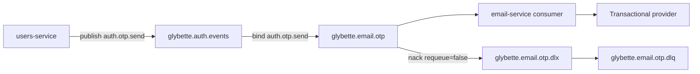

# RabbitMQ in Glybette

This document explains how RabbitMQ is used in this project, how services communicate through it today, and how to extend it for future services like `notifications-service`.

## Why RabbitMQ here

RabbitMQ is used for asynchronous, service-to-service communication when we do not want to block request latency on downstream side effects.

Current example:

- `users-service` creates OTP and publishes an event
- `email-service` consumes the event and sends email

This gives:

- loose coupling between business logic and delivery providers
- retry/dead-letter behavior at the queue level
- easier evolution into additional consumers later

## Current architecture

## Source of truth in code

Messaging package:

- `packages/messaging/src/topology.ts`
- `packages/messaging/src/contracts.ts`
- `packages/messaging/src/rabbit.ts`

Publisher:

- `apps/users-service/src/services/otp.service.ts`

Consumer:

- `apps/email-service/src/index.ts`

## Topology and naming conventions

Defined in `packages/messaging/src/topology.ts`:

- Exchange: `glybette.auth.events` (`topic`)
- Main queue: `glybette.email.otp`
- DLX: `glybette.email.otp.dlx`
- DLQ: `glybette.email.otp.dlq`
- Routing key: `auth.otp.send`

Conventions used:

- exchanges are domain-scoped (`glybette.auth.events`)
- routing keys are intent-based (`auth.otp.send`)
- queue names include owning consumer/service (`glybette.email.*`)

## Event contract

Defined in `packages/messaging/src/contracts.ts`:

- `OtpEmailRequestedEvent`
    - `eventId`
    - `correlationId`
    - `userId`
    - `email`
    - `otpCode`
    - `purpose`
    - `expiresAtIso`
    - `requestedAtIso`

Runtime validation helper:

- `isOtpEmailRequestedEvent(value)`

Use this pattern for every new event: strong TypeScript type + runtime guard.

## How communication works today

### 1) Connect and assert topology

Both publisher and consumer call:

- `connectRabbitMq(RABBITMQ_URL)`
- `ensureAuthEmailTopology(channel)`

This keeps service startup self-sufficient (topology exists before publish/consume).

### 2) Publish from users-service

`OtpService.requestVerificationOtp()` in `apps/users-service/src/services/otp.service.ts`:

- creates OTP record
- builds `OtpEmailRequestedEvent`
- calls `rabbit.publishJson(ROUTING_KEY_AUTH_OTP_SEND, event, headers)`

### 3) Consume in email-service

`apps/email-service/src/index.ts`:

- subscribes with `consumeJson(AUTH_EMAIL_QUEUE, handler)`
- validates payload with `isOtpEmailRequestedEvent`
- sends email through provider adapter
- `ack` on success
- `nack(requeue=false)` on failure, so message goes to DLQ

## Reliability model

From `packages/messaging/src/rabbit.ts`:

- messages are published with `persistent: true`
- consumers explicitly `ack` successful handling
- failed processing sends message to DLQ via `nack(..., false, false)`

Implication:

- delivery is at-least-once
- consumers should be idempotent (safe on duplicate delivery)

## Environment variables

Publisher/consumer shared:

- `RABBITMQ_URL`

Email-specific:

- `EMAIL_PROVIDER` (`mock` or `resend`)
- `EMAIL_FROM`
- `RESEND_API_KEY` (required for `resend`)

Ports are managed via project env schema:

- `PORT_EMAIL_SERVICE`

## How to add a new event

Example: add a welcome notification event.

1. Add contract in `packages/messaging/src/contracts.ts`
2. Add routing key + queue constants in `packages/messaging/src/topology.ts`
3. Update topology assertion in `packages/messaging/src/rabbit.ts`
4. Export all new symbols in `packages/messaging/src/index.ts`
5. Publish from producer service
6. Consume from target service

## How to add a future `notifications-service`

Goal: allow `users-service` (and later other services) to publish notification events consumed by `notifications-service`.

Recommended approach:

1. Add notification routing keys and queues

- Example keys:
    - `notifications.email.send`
    - `notifications.push.send`
    - `notifications.inapp.create`
- Example queues:
    - `glybette.notifications.email`
    - `glybette.notifications.push`
    - each with `*.dlx` and `*.dlq`

2. Create event contracts in `packages/messaging`

- `NotificationEmailRequestedEvent`
- `NotificationPushRequestedEvent`

3. Extend `ensureAuthEmailTopology` into a broader initializer

- Option A: rename to `ensureMessagingTopology`
- Option B: keep auth and notifications initializers separate (cleaner ownership)

4. Implement `apps/notifications-service`

- connect to RabbitMQ
- assert its topology
- consume relevant queues
- route to providers (email/push/SMS/in-app)
- expose `/health`

5. Publish from producers

- `users-service` can publish notification events for onboarding and security alerts
- other services can publish without direct dependency on delivery providers

6. Idempotency and observability

- include `correlationId` and stable `eventId`
- log structured JSON in producer and consumer
- track success/failure counts per routing key

## Producer/consumer usage pattern

Use these helpers from `@glybette/messaging`:

- `connectRabbitMq(url)`
- `ensureAuthEmailTopology(channel)` (or future generalized topology init)
- `publishJson(routingKey, payload, headers?)`
- `consumeJson(queue, handler)`

Guidelines:

- keep payloads small and explicit
- version contracts when making breaking changes
- never trust payload shape without runtime validation
- avoid business-side effects before payload validation

## Operational tips

- RabbitMQ management UI (docker default): `http://localhost:15672`
- Verify bindings:
    - exchange `glybette.auth.events`
    - queue `glybette.email.otp`
    - routing key `auth.otp.send`
- If emails are not being sent:
    - check queue depth and consumer health
    - inspect DLQ `glybette.email.otp.dlq`
    - verify `RABBITMQ_URL` and provider env vars

## Suggested near-term improvements

- Add message schema version field (`schemaVersion`)
- Add per-message retry/backoff policy before DLQ
- Add dedicated metrics (published, consumed, failed, DLQ count)
- Add integration test that publishes event and asserts consumer handling path
